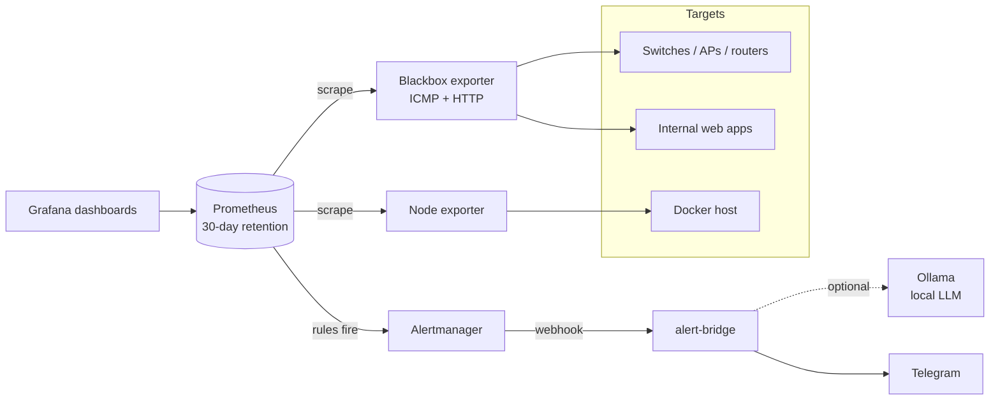

# Office Monitoring Stack

A ready-to-run monitoring stack for a small office or homelab: it watches network devices, internal web apps and the server itself, and sends alerts to **Telegram**, optionally with a short **AI triage hint from a local LLM** (Ollama).

It is a clean, generic version of a setup I built and run at work, where it watches dozens of targets (switches, Wi-Fi access points, servers and internal apps) around the clock. No employer configuration, addresses or data are included; the example targets are placeholders.



## What you get

| Part | What it does |
|------|--------------|
| **Prometheus** | Scrapes everything every 30 s, keeps 30 days of history, evaluates the alert rules |
| **Blackbox exporter** | Pings network devices (ICMP) and checks web apps (HTTP status, TLS expiry) |
| **Node exporter** | CPU, memory, disk and network of the Docker host |
| **Alertmanager** | Groups and de-duplicates alerts; a device that is down does not also spam latency alerts |
| **alert-bridge** | Small Python service (standard library only) that turns alerts into readable Telegram messages |
| **Grafana** | Provisioned "Office Network Overview" dashboard: devices up/down, apps down, firing alerts, ping latency, host CPU, memory and disk |

### Alert rules included

`DeviceDown`, `DeviceHighLatency`, `AppDown`, `CertificateExpiresSoon`, `HostHighCpu`, `HostLowMemory`, `HostDiskAlmostFull`, `TargetScrapeFailing` (see `prometheus/rules/alerts.yml`).

### Example Telegram message

```
🔴 [CRITICAL] ap-floor-1 (192.168.1.21) is not answering ping
No ICMP reply for 2 minutes. Check power, cable and the uplink port.
Target: 192.168.1.21
Since: 2026-11-09 08:15:00 UTC

🤖 AI hint (verify before acting):
Likely cause: the access point lost power or its uplink.
First check: the PoE port on the switch it is connected to.
```

## AI hint: advice only

When `OLLAMA_URL` is set, the bridge asks a local model for a two-line "likely cause / first check" note. The design keeps the model on a short leash:

- The alert is always sent, even if the model is slow or down.
- The prompt only contains the alert's own labels and annotations, and tells the model not to invent device names or numbers.
- The hint is labelled as AI and the bridge **never executes anything**. A person decides what to do.
- Resolved alerts skip the model entirely.

## Run it

```bash
cp .env.example .env        # set GRAFANA_ADMIN_PASSWORD and the Telegram values
# edit prometheus/prometheus.yml: replace the example IPs and URLs with yours
docker compose up -d
```

- Grafana: http://localhost:3000 (dashboard is in the *Monitoring* folder)
- Prometheus: http://localhost:9090
- Alertmanager: http://localhost:9093

Prometheus, Alertmanager and Grafana are bound to `127.0.0.1` by default. Set `GRAFANA_BIND=0.0.0.0` only if Grafana should be reachable from your LAN, and keep these ports off the public internet.

To reload Prometheus after editing targets or rules: `curl -X POST http://localhost:9090/-/reload`.

## Tests

```bash
cd bridge && python3 -m unittest -v
```

The tests cover message formatting, resolved alerts, and the guarantee that a failing model never blocks an alert.

## Layout

```
docker-compose.yml
prometheus/prometheus.yml        scrape targets (edit these)
prometheus/rules/alerts.yml      alert rules
alertmanager/alertmanager.yml    routing to the bridge
blackbox/blackbox.yml            ICMP and HTTP probe modules
grafana/                         datasource, dashboard provider, dashboard JSON
bridge/                          alert-bridge service and its tests
```

## License

MIT
